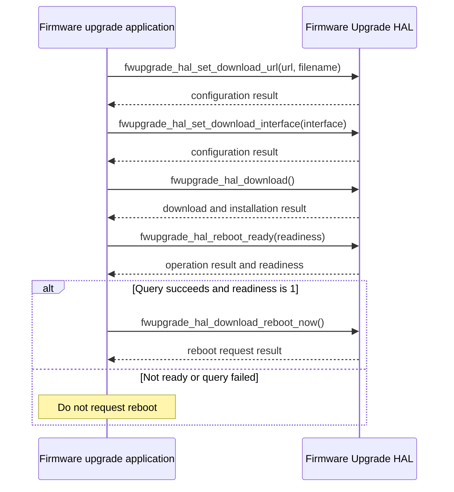

# Firmware Upgrade HAL Specification

## Version History

| Date | Comment | Version |
| --- | --- | --- |
| — | Documentation alignment; no ABI change. | — |

## Acronyms

HAL means Hardware Abstraction Layer; CPE means Customer Premises Equipment; OEM means Original Equipment Manufacturer; URL means Uniform Resource Locator.

## Description

The firmware upgrade application uses this HAL to configure image downloads, download and install firmware, inspect progress and reboot readiness, and request reboot or update with factory reset. The vendor implementation integrates the platform download and flashing mechanisms.

## Component Runtime Execution Requirements

### Initialization and Startup

For a configured download, set the image URL and local filename, select the download interface, and call `fwupgrade_hal_download`. The direct-URL installation API is a separate entry point.

### Threading and Process Model

Serialize application access to shared upgrade configuration and operations. Vendor implementations must coordinate access across caller processes.

### Memory Model

Callers own input strings and output storage and must keep them valid throughout each call. The download-configuration getter requires at least 1024 bytes for the URL and 256 bytes for the filename. Consume output only after a successful return and follow the vendor string-termination contract.

### Error Reporting

Status-returning operations use `RETURN_OK` (`0`) and `RETURN_ERR` (`-1`), with an additional `400` result for `fwupgrade_hal_download`. The download-status getter instead returns progress or an error category; use the values below rather than testing it as a zero-success operation.

### Persistence and Recovery

Update and factory reset change firmware and device configuration. Authorize disruptive operations and prepare product-specific recovery before installation, reboot, or factory reset.

## Nonfunctional Requirements

### Logging and Debugging

Implementations must not log credentials, secrets, security-sensitive information, or other sensitive data. Log operation outcomes rather than download URLs or sensitive payloads.

### Quality Control

Use compiler warnings, static analysis, and memory checking. Validate configuration buffers, return handling, download failures, and reboot readiness. Firmware installation and reset tests require authorized hardware and recovery procedures.

### Licensing

See repository Apache-2.0 notices and the vendor implementation's licensing.

### Build Requirements

Include `fwupgrade_hal.h` and link the product implementation. Existing integration guidance identifies the shared library as `libfw_upgrade.so`; confirm the target recipe and linker configuration.

## Interface API Documentation

| Function | Contract |
| --- | --- |
| `INT fwupgrade_hal_set_download_url(char *pUrl, char *pfilename)` | Set the image URL and local download filename. |
| `INT fwupgrade_hal_get_download_url(char *pUrl, char *pfilename)` | Retrieve the configured URL and filename into caller storage described in Memory Model. |
| `INT fwupgrade_hal_set_download_interface(unsigned int interface)` | Select `0` for `wan0` or `1` for `erouter0` for HTTP downloads. |
| `INT fwupgrade_hal_get_download_interface(unsigned int *pinterface)` | Retrieve the configured interface identifier using the same mapping. |
| `INT fwupgrade_hal_download()` | Fetch, validate, and install the configured image. Returns `RETURN_OK` for successful download and installation, `RETURN_ERR` for general failure, or `400` for an invalid URL or hostname-resolution failure. |
| `INT fwupgrade_hal_get_download_status()` | Return progress or an error category from the table below. |
| `INT fwupgrade_hal_reboot_ready(ULONG *pValue)` | Return operation status and, on success, write `1` for ready or `2` for not ready. |
| `INT fwupgrade_hal_download_reboot_now()` | Request immediate reboot to apply downloaded firmware; returns failure if reboot is already in progress or another error occurs. |
| `INT fwupgrade_hal_update_and_factoryreset()` | Initiate firmware update and perform factory reset after successful completion. |
| `INT fwupgrade_hal_download_install(const char *url)` | Download from the supplied URL and initiate installation. |

### Download Status Values

These values apply to `fwupgrade_hal_get_download_status`, not to all API return values.

| Value | Meaning |
| --- | --- |
| `0` | Download not started. |
| `1`–`99` | Percentage downloaded. |
| `100` | Download complete, pending reboot. |
| `400` | Invalid HTTP server URL. |
| `401` | Cannot connect to HTTP server. |
| `402` | File not found on HTTP server. |
| `403` | Hardware type download-protection failure. |
| `404` | Hardware mask download-protection failure. |
| `405` | Download revision-protection failure. |
| `406` | Download header-protection failure. |
| `407` | Download CVC failure. |
| `500` | General download failure. |

## Theory of Operation and Key Concepts

Check each configuration and download result before continuing dependent steps. Download completion and reboot readiness are distinct observations. Read readiness only after its getter succeeds, and request reboot only when ready. Confirm device recovery through the platform integration after reboot; a successful request is not proof of restored service.

## Sequence Diagram

The configured-download example stops on configuration, download, or readiness-query failure. It does not prescribe automatic retries.

## Source References

- [fwupgrade_hal.h](https://github.com/rdkcentral/rdkb-halif-fwupgrade/blob/develop/include/fwupgrade_hal.h)
